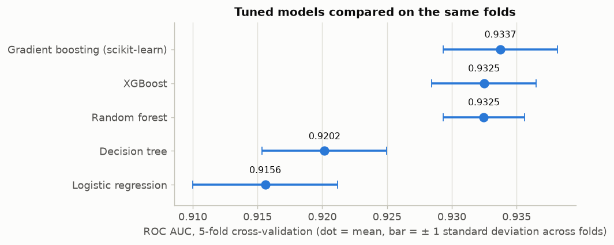
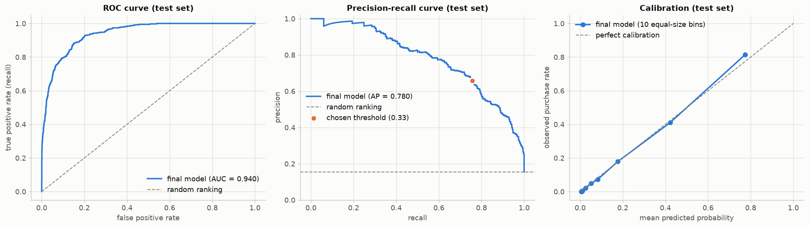
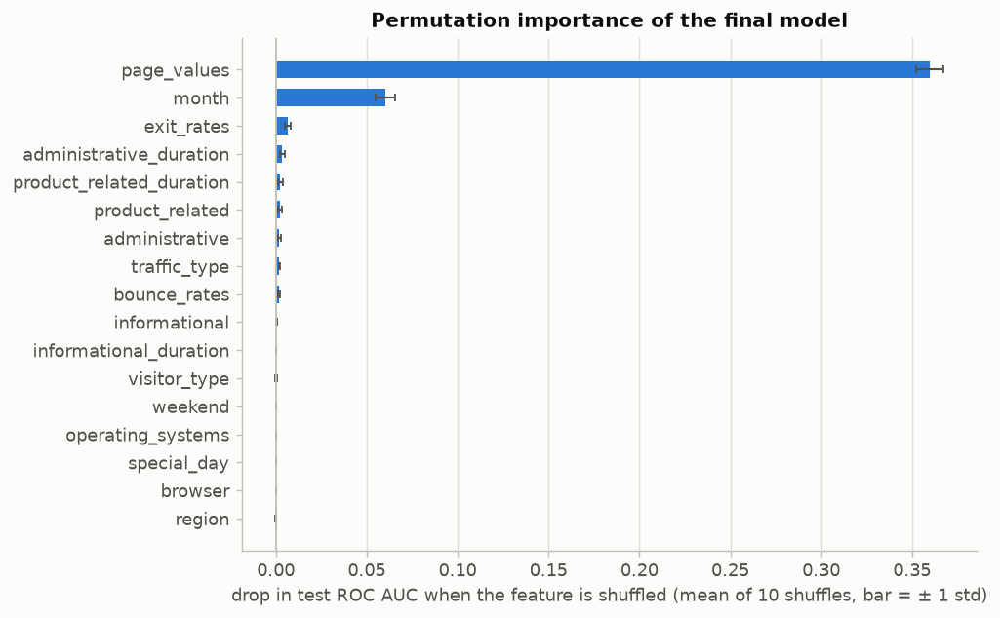

# Online shopper purchase prediction

**ML Zoomcamp 2026 · midterm project**

[](https://github.com/spirtalio1985/ML-Zoomcamp-2026/actions/workflows/ci.yml)

A machine-learning service that estimates, from the way a visitor browses an online shop, the
probability that the session ends with a purchase.

* Data: 12,330 real browsing sessions of an e-commerce site (UCI "Online Shoppers Purchasing Intention").
* Model: gradient-boosted trees (scikit-learn), selected among five tuned model families.
* Result on the held-out test set: **ROC AUC 0.940**, average precision 0.780 (purchase rate: 15.5%).
* Delivery: FastAPI web service, `uv` environment, Docker image, Kubernetes manifests, cloud deployment guide.

---

## Contents

1. [Problem description](#1-problem-description)
2. [Data](#2-data)
3. [Repository structure](#3-repository-structure)
4. [EDA highlights](#4-eda-highlights)
5. [Model training and selection](#5-model-training-and-selection)
6. [Final model: results on the test set](#6-final-model-results-on-the-test-set)
7. [How to run the project](#7-how-to-run-the-project)
8. [Web service (API)](#8-web-service-api)
9. [Docker](#9-docker)
10. [Cloud and Kubernetes deployment](#10-cloud-and-kubernetes-deployment)
11. [Limitations and next steps](#11-limitations-and-next-steps)
12. [Evaluation criteria: where to find what](#12-evaluation-criteria-where-to-find-what)

---

## 1. Problem description

### The problem

Most visits to an online shop end without a purchase: in this dataset only about 1 session in 6.5
(15.5%) converts. Shops spend money on bringing visitors to the site, and then lose most of them.

If the shop could tell **while a visitor is still browsing** how likely the visit is to end with a
purchase, it could spend its attention and its incentives where they matter instead of treating
every visitor the same way.

### What the model predicts

For one browsing session, described by 17 features (how many pages of each type were viewed and
for how long, Google Analytics metrics of those pages, the month, the traffic source, the type of
visitor, and so on), the model returns

* `purchase_probability`: the estimated probability that the session ends with a transaction;
* `purchase`: a yes/no flag (probability at or above a decision threshold).

This is a **binary classification** problem with an imbalanced target.

### How the solution is used

The model is packaged as a small web service (`POST /predict`). The shop's website or its
marketing system sends the current state of a session and gets the probability back. Typical uses:

| Use | How the prediction is used |
|---|---|
| Targeted incentives | Show an offer (free delivery, a discount code, a chat prompt) only to visitors in a chosen probability band, instead of giving discounts to visitors who would buy anyway or who are not interested at all. |
| Prioritising follow-up | Rank sessions that ended without a purchase by probability, and send basket reminders or retargeting ads to the most promising ones first. |
| Monitoring traffic quality | Track the share of high-probability sessions per traffic source or campaign as an early quality signal. |

The service returns a calibrated probability rather than only a label, because each use needs its
own operating point. The default flag uses the threshold that maximises F1 (0.33); section 6
shows the precision/recall trade-off for other thresholds.

### How success is measured

Because only 15.5% of sessions convert, accuracy is misleading (always answering "no purchase" is
84.5% accurate). Models are compared with

* **ROC AUC** (main metric): how well the model ranks purchasing sessions above the others;
* **average precision** (area under the precision-recall curve), which focuses on the rare class.

Precision, recall and F1 at the chosen threshold are reported for the final model.

---

## 2. Data

[Online Shoppers Purchasing Intention Dataset](https://archive.ics.uci.edu/dataset/468/online+shoppers+purchasing+intention+dataset),
UCI Machine Learning Repository (Sakar & Kastro, 2018), licence CC BY 4.0.

* 12,330 sessions, each from a different user, collected over one year.
* 17 features and the target `Revenue` (1,908 sessions with a purchase, 10,422 without).
* No missing values.

**The dataset is committed to this repository** (`data/online_shoppers_intention.csv`, 1 MB), so
nothing has to be downloaded. Source, licence, checksum, provenance of the file and a description
of every column are in [`data/README.md`](data/README.md).

| Group | Features |
|---|---|
| Pages viewed, by type | `administrative`, `informational`, `product_related` |
| Time spent (seconds), by type | `administrative_duration`, `informational_duration`, `product_related_duration` |
| Google Analytics metrics of the pages viewed | `bounce_rates`, `exit_rates`, `page_values` |
| Calendar | `month`, `weekend`, `special_day` (closeness to a day such as Valentine's Day) |
| Visitor and technical context | `visitor_type`, `traffic_type`, `operating_systems`, `browser`, `region` |

---

## 3. Repository structure

```
├── README.md                  this file
├── notebook.ipynb             data preparation, EDA, feature importance, model selection and tuning
├── train.py                   trains the final model and saves it to model.bin
├── predict.py                 web service (FastAPI) that loads model.bin and serves predictions
├── features.py                feature definitions shared by training and serving
├── send_request.py            small client that calls a running service
├── model.bin                  the trained model (pipeline + decision threshold + metadata)
├── data/
│   ├── online_shoppers_intention.csv
│   └── README.md              source, licence, checksum and data dictionary
├── tests/test_predict.py      tests for the feature code and the web service
├── pyproject.toml             dependencies (runtime + development)
├── uv.lock                    exact versions of all dependencies
├── .python-version            Python version used by uv
├── Dockerfile                 image of the web service
├── k8s/                       Kubernetes deployment and service
├── .github/workflows/ci.yml   automated checks (tests, training, notebook, Docker, Kubernetes)
└── images/                    figures used in this README
```

---

## 4. EDA highlights

The full analysis is in [`notebook.ipynb`](notebook.ipynb) (sections 2 to 5). It covers data types
and ranges, missing values, duplicates, the target, every numerical and categorical feature,
correlations, and a feature importance analysis. The integrity checks use the whole file; the
analysis of the target and the features (notebook sections 4 and 5) uses the training part only.

* **Clean data.** No missing values. 125 rows are exact copies of another row; they are all
  one- or two-page "bounce" visits without a purchase and are kept. One label is fixed
  (`June` → `Jun`).
* **Imbalanced target.** 15.5% of sessions end with a purchase.
* **Skewed numerical features.** Page counts, durations and `page_values` have long right tails
  and many zeros. A `log(1 + x)` transform lifts logistic regression from a cross-validated
  ROC AUC of 0.889 to 0.916.
* **`page_values` is the strongest single feature.** Used alone as a score it reaches a ROC AUC of
  0.86. Sessions with a positive page value convert 56% of the time, the others 4%.
* **Season matters.** The purchase rate rises from 1.5% in February to 26% in November.
* **New visitors convert more often** than returning ones (25% against 14%).
* **Redundant features.** Each page count is strongly correlated with its duration (Spearman
  0.88 to 0.95), and bounce rate with exit rate (0.60).
* **Integer codes are categories.** `operating_systems`, `browser`, `region` and `traffic_type`
  are arbitrary codes, so they are one-hot encoded; several codes are rare.

---

## 5. Model training and selection

Details and all tables are in sections 6 to 8 of the notebook.

**Protocol**

* Stratified split: 60% train, 20% validation, 20% test (`random_state=1`). The dataset has no
  timestamps, so a time-based split is not possible.
* First models with default parameters are compared on the validation part.
* For tuning, train and validation are merged (80%) and every candidate is evaluated with
  **stratified 5-fold cross-validation** on identical folds.
* The test part is used once, for the final model only.

**Models and tuned parameters**

| Model | Tuned | Best setting |
|---|---|---|
| Logistic regression (linear) | `C`, raw or `log(1 + x)` inputs | `C=0.01`, log inputs |
| Decision tree | `max_depth`, `min_samples_leaf` | depth 10, 100 samples per leaf |
| Random forest | `max_features`, `max_depth`, `min_samples_leaf` | 500 trees, `max_features=0.3`, depth 10, 10 samples per leaf |
| XGBoost | `eta`, `max_depth`, `min_child_weight`, number of trees | `eta=0.05`, depth 4, `min_child_weight=15`, 150 trees |
| Gradient boosting (scikit-learn `HistGradientBoostingClassifier`) | `learning_rate`, `max_leaf_nodes`, `min_samples_leaf`, iterations | `learning_rate=0.05`, 16 leaves, 50 samples per leaf, 75 iterations |

**Cross-validated results** (mean ± standard deviation over the 5 folds)

| Model | ROC AUC | Average precision |
|---|---|---|
| **Gradient boosting (scikit-learn)** | **0.9337 ± 0.0044** | 0.7474 ± 0.0122 |
| XGBoost | 0.9325 ± 0.0040 | 0.7489 ± 0.0116 |
| Random forest | 0.9325 ± 0.0032 | 0.7500 ± 0.0130 |
| Decision tree | 0.9202 ± 0.0048 | 0.7019 ± 0.0093 |
| Logistic regression | 0.9156 ± 0.0056 | 0.6788 ± 0.0319 |
| *Reference: `page_values` alone (validation part)* | *0.871* | *0.632* |



**Selection.** The three tree ensembles cannot be separated with five folds: their differences
(about 0.001 in ROC AUC) are one to two standard errors of the paired difference, and by average
precision their order is reversed. All three are clearly better than the single tree and the
linear model. I selected **gradient boosting from scikit-learn**: it has the highest mean ROC AUC,
and between tied models it is the most practical one to deploy. It needs no extra library in the
web service (XGBoost would add several hundred MB of native libraries to the Linux image), and
the saved model is under 0.2 MB.

---

## 6. Final model: results on the test set

The final model is trained on the 80% training part and evaluated once on the 20% test part
(2,466 sessions, 382 purchases).

| Metric | Test set | 95% bootstrap interval |
|---|---|---|
| ROC AUC | **0.9401** | 0.9285 to 0.9498 |
| Average precision | **0.7801** | 0.7394 to 0.8150 (a random ranking scores 0.155) |
| Brier score | 0.0651 | (always predicting the base rate: 0.131) |

At the default threshold of 0.33 (maximum F1 on out-of-fold predictions of the training part):

| | Predicted: no purchase | Predicted: purchase |
|---|---|---|
| **Actual: no purchase** | 1,933 | 151 |
| **Actual: purchase** | 93 | 289 |

Precision 0.657 · recall 0.757 · F1 0.703. In words: the model finds about three out of four
purchasing sessions, and about two out of three flagged sessions really end with a purchase.



**Choosing another threshold.** Estimated on out-of-fold predictions of the training part:

| Threshold | Precision | Recall | F1 | Sessions flagged |
|---|---|---|---|---|
| 0.10 | 0.46 | 0.90 | 0.61 | 30% |
| 0.20 | 0.55 | 0.82 | 0.66 | 23% |
| 0.30 | 0.62 | 0.75 | 0.68 | 19% |
| **0.33 (default)** | 0.64 | 0.73 | 0.69 | 18% |
| 0.50 | 0.72 | 0.60 | 0.66 | 13% |
| 0.70 | 0.84 | 0.37 | 0.51 | 7% |

**What drives the predictions.** Permutation importance on the test set (drop in ROC AUC when one
feature is shuffled):



`page_values` dominates, `month` is a distant second and the exit rate third. Without
`page_values` the cross-validated ROC AUC falls from 0.934 to 0.781.

---

## 7. How to run the project

Everything below was run on Linux (x86-64) with Python 3.11 and `uv`. `uv`, Docker and the
commands used here are cross-platform; where a command differs on Windows, both forms are given.

### 7.1 Requirements

* [uv](https://docs.astral.sh/uv/getting-started/installation/) (it installs the right Python version by itself)
* Docker (only for sections 9 and 10)

### 7.2 Get the code and install the dependencies

Clone this repository, open a terminal in its root folder and run:

```bash
uv sync --locked
```

`uv sync --locked` creates a **virtual environment** in `.venv/` with Python 3.11 and installs the
exact package versions recorded in `uv.lock` (runtime and development dependencies).

Activate the environment:

```bash
source .venv/bin/activate        # Linux / macOS
.venv\Scripts\activate           # Windows
```

Alternatively, skip the activation and prefix each command with `uv run` (for example
`uv run python train.py`). The commands below assume the environment is activated.

Dependencies are declared in [`pyproject.toml`](pyproject.toml):

* runtime (needed by the web service, installed in the Docker image): `fastapi`, `uvicorn`,
  `scikit-learn`, `numpy`;
* development (training, notebook, tests): `pandas`, `matplotlib`, `xgboost`, `notebook`,
  `nbconvert`, `ipykernel`, `pytest`, `httpx`, `requests`.

> The development environment is large on Linux (about 1.3 GB), mostly because XGBoost brings a
> GPU communication library with it. The Docker image contains only the runtime dependencies.
>
> macOS only: XGBoost (used in the notebook, not by the service) needs the OpenMP runtime:
> `brew install libomp`.

### 7.3 Train the model

```bash
python train.py
```

This loads the data, runs the 5-fold cross-validation, trains the final model, evaluates it on the
test set and writes `model.bin`. It takes a few seconds. Expected output (abridged):

```
5-fold cross-validation on the training part
  mean  : ROC AUC = 0.9337 +- 0.0044 | average precision = 0.7474 +- 0.0122

Decision threshold (max F1 on out-of-fold predictions): 0.33

Held-out test set
  ROC AUC           = 0.9401
  average precision = 0.7801   (a random ranking would score 0.1549)
  Brier score       = 0.0651
  at threshold 0.33: precision = 0.6568 | recall = 0.7565 | F1 = 0.7032
  confusion matrix: TP = 289 | FP = 151 | FN = 93 | TN = 1933

Model saved to .../model.bin
```

A trained `model.bin` is already in the repository, so this step is optional. On another
operating system or processor the last decimals may differ slightly.

`model.bin` is a pickle file. It has to be loaded with the library versions recorded in `uv.lock`
(scikit-learn 1.7.2), which is what `uv sync --locked` and the Docker image install.

### 7.4 Run the notebook

```bash
jupyter notebook notebook.ipynb
```

or re-execute it from the command line (about five minutes on a 2-core machine):

```bash
jupyter nbconvert --to notebook --execute --inplace notebook.ipynb
```

The notebook is committed with all outputs, so it can also be read directly on GitHub.

### 7.5 Run the tests

```bash
pytest
```

The tests check the feature preparation, the API (valid and invalid requests) and that the
service scores real rows of the dataset exactly like the training code.

### 7.6 Start the web service locally

```bash
uvicorn predict:app --host 0.0.0.0 --port 9696
```

In a second terminal (with the environment activated):

```bash
python send_request.py
```

Output:

```
GET /health -> {'status': 'ok', 'model': 'HistGradientBoostingClassifier', 'threshold': 0.33}
POST /predict [engaged visitor (many product pages, high page value)] -> {'purchase_probability': 0.773323, 'purchase': True, 'threshold': 0.33}
POST /predict [bounce (one product page, left immediately)] -> {'purchase_probability': 0.010392, 'purchase': False, 'threshold': 0.33}
```

The interactive API documentation is at <http://localhost:9696/docs>.

### 7.7 Automated checks

Every push to this repository runs [`.github/workflows/ci.yml`](.github/workflows/ci.yml) on a
clean Ubuntu machine. The workflow repeats the steps of this README:

| Job | What it does |
|---|---|
| Tests and training script | checks the checksum of the dataset, installs the environment from `uv.lock`, runs `pytest`, runs `train.py` and compares its results and the retrained model with the values in this README and with `model.bin` |
| Notebook | re-executes `notebook.ipynb` from top to bottom |
| Docker image | builds the image, starts the container and sends the example requests |
| Kubernetes deployment | creates a kind cluster, deploys the manifests in `k8s/` and sends the example requests through the service |

The results of all runs are public:
<https://github.com/spirtalio1985/ML-Zoomcamp-2026/actions/workflows/ci.yml>

---

## 8. Web service (API)

| Endpoint | Purpose |
|---|---|
| `GET /health` | Liveness check; returns the model name and the decision threshold |
| `POST /predict` | Purchase probability for one session |
| `GET /docs` | Interactive documentation (Swagger UI) generated by FastAPI |

**Request body of `POST /predict`** (all 17 fields are required):

| Field | Type | Allowed values |
|---|---|---|
| `administrative`, `informational`, `product_related` | integer | ≥ 0 |
| `administrative_duration`, `informational_duration`, `product_related_duration` | number (seconds) | ≥ 0 |
| `bounce_rates`, `exit_rates` | number | 0 to 1 |
| `page_values` | number | ≥ 0 |
| `special_day` | number | 0 to 1 |
| `month` | string | `Jan`, `Feb`, …, `Dec` (three-letter abbreviations) |
| `operating_systems`, `browser`, `region`, `traffic_type` | integer code | ≥ 1 |
| `visitor_type` | string | `Returning_Visitor`, `New_Visitor`, `Other` |
| `weekend` | boolean | `true`, `false` |

Invalid or incomplete requests are rejected with HTTP 422 and a description of the problem. Codes
or months that did not occur in the training data are accepted and treated as "unknown".

**Example with curl**

```bash
curl -s -X POST http://localhost:9696/predict \
  -H "Content-Type: application/json" \
  -d '{
    "administrative": 3,
    "administrative_duration": 87.5,
    "informational": 0,
    "informational_duration": 0.0,
    "product_related": 34,
    "product_related_duration": 1280.4,
    "bounce_rates": 0.004,
    "exit_rates": 0.017,
    "page_values": 21.3,
    "special_day": 0.0,
    "month": "Nov",
    "operating_systems": 2,
    "browser": 2,
    "region": 1,
    "traffic_type": 2,
    "visitor_type": "Returning_Visitor",
    "weekend": false
  }'
```

Response:

```json
{
  "purchase_probability": 0.640714,
  "purchase": true,
  "threshold": 0.33
}
```

---

## 9. Docker

The [`Dockerfile`](Dockerfile) builds an image that contains only the web service: Python 3.11,
the runtime dependencies from `uv.lock`, `predict.py`, `features.py` and `model.bin`.

Build the image:

```bash
docker build -t purchase-prediction:v1 .
```

Run the container:

```bash
docker run -it --rm -p 9696:9696 purchase-prediction:v1
```

Test it from another terminal:

```bash
python send_request.py
# or
curl http://localhost:9696/health
```

Stop the container with `Ctrl+C`.

---

## 10. Cloud and Kubernetes deployment

Two options are documented. Both use the Docker image from section 9.

### Option A: Fly.io (public URL)

```bash
# install flyctl: https://fly.io/docs/flyctl/install/
fly auth signup            # or: fly auth login

# from the root of this repository; creates the app and a fly.toml from the Dockerfile
fly launch --generate-name
fly deploy
```

`fly launch` builds the app from the `Dockerfile` and writes a `fly.toml`; check that it contains
`internal_port = 9696` (the port the service listens on) and commit the file. At the end of
`fly deploy` the URL of the app is printed (`https://<app-name>.fly.dev`). Test the deployed
service:

```bash
python send_request.py https://<app-name>.fly.dev
```

Remove the app when it is no longer needed, to avoid costs:

```bash
fly apps destroy <app-name>
```

### Option B: Kubernetes (local cluster with kind)

The manifests are in [`k8s/`](k8s): a `Deployment` (one replica, readiness and liveness probes on
`/health`, resource requests and limits) and a `ClusterIP` `Service`.

```bash
# requires Docker, kind and kubectl
docker build -t purchase-prediction:v1 .

kind create cluster --name purchase-prediction
kind load docker-image purchase-prediction:v1 --name purchase-prediction

kubectl apply -f k8s/ --context kind-purchase-prediction
kubectl rollout status deployment/purchase-prediction --context kind-purchase-prediction
kubectl get pods,services --context kind-purchase-prediction

# forward local port 9696 to the service, then test from another terminal
kubectl port-forward service/purchase-prediction 9696:80 --context kind-purchase-prediction
python send_request.py
```

Clean up:

```bash
kind delete cluster --name purchase-prediction
```

For a remote cluster, push the image to a container registry and set the `image:` field in
`k8s/deployment.yaml` to the registry path.

### Proof of deployment

The Kubernetes deployment (option B) is created and tested automatically. On every push, the
`kubernetes` job of the [CI workflow](.github/workflows/ci.yml) builds the Docker image on a clean
Ubuntu machine, creates a kind cluster, applies the manifests in `k8s/`, waits for the rollout and
sends the example requests of `send_request.py` through the Kubernetes service. The job fails
when the answers differ from the ones shown in [section 7.6](#76-start-the-web-service-locally).

All runs are public: <https://github.com/spirtalio1985/ML-Zoomcamp-2026/actions/workflows/ci.yml>.
The summary page of a run shows the pods, the service and the answers of the deployed model.

No public instance is kept running, to avoid costs; option A gives a public URL in a few minutes.

---

## 11. Limitations and next steps

* **One shop, one year, no timestamps.** The split is random, not chronological. The scores
  describe sessions from the same period, not future traffic. There are no sessions from January
  or April, so the model has never seen those months.
* **Finished sessions.** The features are totals of a completed session. Scoring a session that is
  still in progress means sending partial totals; how accurate the model is early in a session
  cannot be measured with this dataset.
* **Dependence on one metric.** Most of the predictive power comes from `page_values`, a Google
  Analytics metric that reflects visits to pages close to the transaction. The service is only as
  good as the availability of that metric.
* **Anonymous codes.** The meaning of the browser, region and traffic codes is not documented, so
  the model cannot be transferred to another shop.
* **Threshold.** The default threshold maximises F1. A real deployment should choose it from the
  cost of an intervention and the value of a sale, ideally with an A/B test, since predicting a
  purchase is not the same as knowing whether an offer changes the outcome.

Possible next steps: evaluate on click-stream data with timestamps (time-based validation and
scoring during the session), calibrate the threshold on business costs, and monitor the input
distributions in production.

---

## 12. Evaluation criteria: where to find what

| Criterion | Where |
|---|---|
| Problem description | [Section 1](#1-problem-description) |
| EDA | `notebook.ipynb`, sections 2 to 5 (ranges, missing values, duplicates, target, every feature, correlations, feature importance); summary in [section 4](#4-eda-highlights) |
| Model training | `notebook.ipynb`, sections 6 to 8: linear model, decision tree, random forest, XGBoost and gradient boosting, each with parameter tuning; summary in [section 5](#5-model-training-and-selection) |
| Exporting notebook to script | [`train.py`](train.py) |
| Reproducibility | Data committed in `data/`; exact dependencies in `uv.lock`; commands in [section 7](#7-how-to-run-the-project); every step is re-run on a clean machine by the CI workflow ([section 7.7](#77-automated-checks)) |
| Model deployment | [`predict.py`](predict.py) (FastAPI), [section 8](#8-web-service-api) |
| Dependency and environment management | `pyproject.toml`, `uv.lock`, virtual environment created by `uv sync`; installation and activation in [section 7.2](#72-get-the-code-and-install-the-dependencies) |
| Containerization | [`Dockerfile`](Dockerfile); build and run commands in [section 9](#9-docker) |
| Cloud deployment | Fly.io commands and Kubernetes manifests (`k8s/`) in [section 10](#10-cloud-and-kubernetes-deployment); the Kubernetes deployment is created and tested in CI, see [Proof of deployment](#proof-of-deployment) |

---

## Data licence and citation

The dataset is licensed under CC BY 4.0: Sakar, C. & Kastro, Y. (2018). *Online Shoppers Purchasing
Intention Dataset* [Dataset]. UCI Machine Learning Repository. <https://doi.org/10.24432/C5F88Q>
